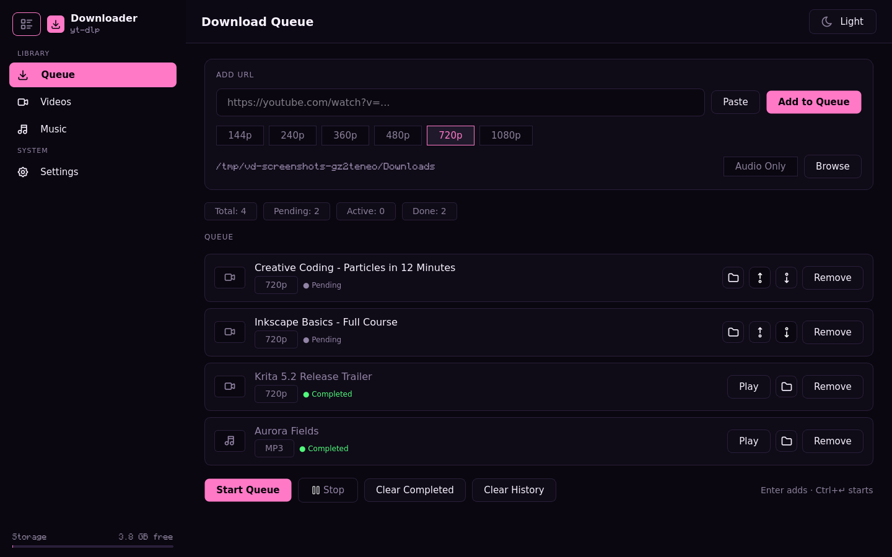
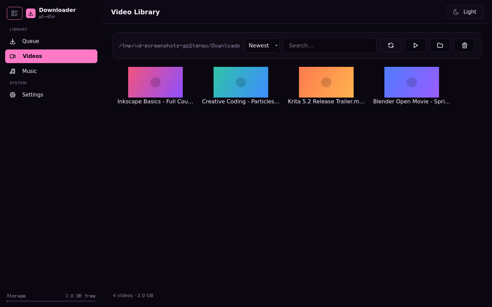
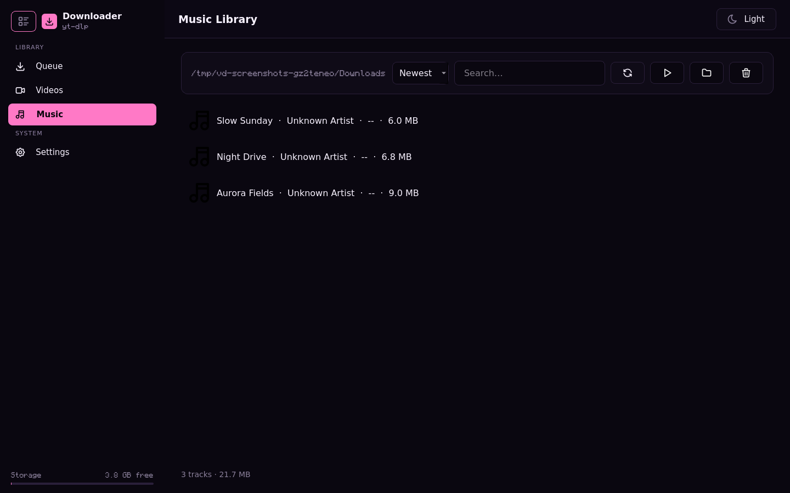
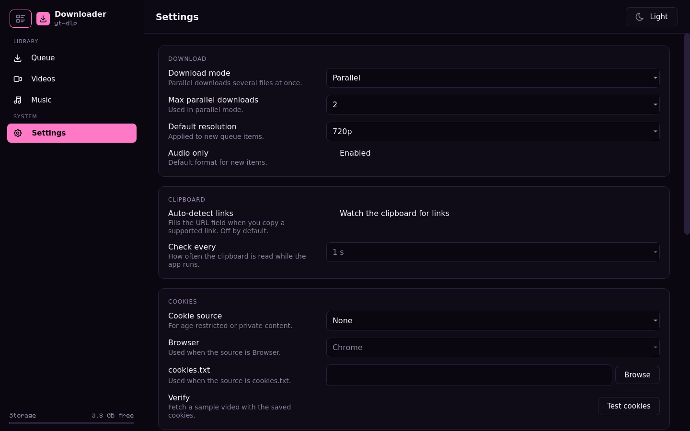

# 🎬 Video Downloader

A modular desktop video downloader built with Python, PySide6 (Qt), and `yt-dlp`. Features a Download Console UI with three theme families (each with a dark and a light mode), a real-time download queue, and local media libraries.

---

## 📸 Screenshots

| Download Console | Video Library |
|---|---|
|  |  |

| Music Library | Settings |
|---|---|
|  |  |

The images are rendered from the real widgets with seeded sample data, not mocked up:
`QT_QPA_PLATFORM=offscreen python docs/make_screenshots.py` regenerates them into
`docs/screenshots/`.

---

## ✨ Features

### Download Console (Queue)
- URL input with live validation and a **Paste** button
- Link preview (title, channel, duration, views, estimated size) fetched off the UI thread
- Resolution pills (144p – 1080p) and an audio-only (MP3) toggle
- Parallel or sequential download modes with a configurable concurrency limit
- Real-time per-row progress with speed, ETA, and transferred size
- Per-item open-folder, cancel, resume, and delete controls
- Reorder pending and paused rows (up/down) so the queue matches the order you want
- Duplicate detection against both the queue and history
- Queue persisted to `queue.json` — survives app restarts; interrupted items resume as pending
- Completed downloads appended to `history.json`, capped at the 1000 most recent entries with a **Clear History** action

### Video Library
- Scans the download folder for video files (`.mp4`, `.mkv`, `.avi`, `.mov`, `.webm`, `.flv`, `.wmv`, `.m4v`)
- Thumbnail grid using a local `.thumbs/` cache (falls back to an icon when no thumbnail exists)
- Search/filter bar
- Play (VLC or system default player) and delete controls via context menu

### Music Library
- Scans the download folder for audio files (`.mp3`, `.m4a`, `.ogg`, `.flac`, `.wav`)
- Reads metadata via `mutagen` (title, artist, duration) on a background thread
- Search/filter bar
- Play and delete controls via context menu

### Settings
- **Download:** parallel vs. sequential mode, max parallel downloads, default resolution, audio-only default
- **General:** auto clipboard detection toggle, clipboard polling interval
- **Cookies:** browser cookie extraction (Chrome, Firefox, Edge, Brave, Opera, Safari) or a custom `cookies.txt` path, plus a **Test cookies** button
- **Appearance:** theme family (Arisu Pink, SaaS Blue, Arch Blue), dark/light mode and interface scale; the top bar keeps a one-click mode toggle
- **Download Engine:** shows the running `yt-dlp` version, whether it is bundled or updated, and a **Check for updates** button that verifies a newer wheel's SHA256 before use

### UI / General
- Sidebar navigation with active-page indicator and a storage meter
- Collapsible sidebar: the burger button at the top toggles an icon-only rail; the state persists in `settings.json`
- Top bar with live item count badge and a light/dark mode toggle
- Three theme families, each with a dark and a light palette: **Arisu Pink** (`#ff79c6`, the original), **SaaS Blue** (`#2563eb` on white) and **Arch Blue** (`#1793d1`) — the single source of truth is `ui/theme.py`
- Interface scale driven by one token: `ui_scale` in `settings.json` (`1.0` = design size, shipped default `1.5`).
- VLC auto-detection; falls back to the system default player if VLC is not found

---

## 📁 Project Structure

```
video_downloader/
├── main.py             # PySide6 entry point — applies theme, starts MainWindow
├── models.py           # DownloadItem dataclass + DownloadStatus enum
├── queue_manager.py    # Pure-Python queue state machine (thread-safe)
├── queue_runner.py     # Threaded download executor emitting Qt signals
├── persistence.py      # Thread-safe atomic JSON (queue, history, settings)
├── thumb_cache.py      # Thumbnail cache keyed by file name
├── downloader.py       # yt-dlp wrapper with progress hooks and cookie support
├── url_validator.py    # URL validation and sanitising
├── config.py           # Constants, resolution list, default settings
├── utils.py            # Resource paths, FFmpeg check, VLC detection
├── ui/
│   ├── theme.py        # Theme families × dark/light tokens + QSS stylesheet
│   ├── icons.py        # Tinted Tabler glyphs, cached per (name, size, colour)
│   ├── sidebar.py      # Navigation rail + storage meter
│   ├── main_window.py  # Shell: sidebar + top bar + stacked pages
│   └── pages/
│       ├── queue_page.py     # Download Console
│       ├── media_page.py     # Shared media browser base
│       ├── videos_page.py    # Video grid
│       ├── music_page.py     # Music list
│       └── settings_page.py  # Settings form
├── tests/              # unittest suite, including an offscreen GUI smoke test
├── assets/             # Tabler PNG icons, app icon, bundled Monocraft + OFL
├── packaging/          # PyInstaller spec, .desktop, AppStream metadata
├── .github/workflows/  # CI: ruff + tests on 3.11–3.13
├── LICENSE             # GPL-3.0-or-later
├── THIRD_PARTY_NOTICES.md
├── requirements.txt
├── requirements-dev.txt
└── pyproject.toml      # Ruff + pytest configuration
```

User state (`queue.json`, `history.json`, `settings.json`, `logs/`, `app.lock`) lives in
one per-user data directory, never next to the code:

| OS | Path |
|----|------|
| Linux | `$XDG_DATA_HOME/video-downloader` (default `~/.local/share/video-downloader`) |
| macOS | `~/Library/Application Support/Video-Downloader` |
| Windows | `%APPDATA%\Video-Downloader` |

Set `VIDEO_DOWNLOADER_DATA_DIR` to override it. On first start, any `queue.json`,
`history.json` or `settings.json` still sitting in the working directory is copied in.
Only one instance can run per data directory.

---

## ⚙️ Requirements

- Python 3.10+
- FFmpeg (required for audio extraction and video merging)
- Git

---

## 🔧 Installation

### 1. Install system dependencies

**Debian / Ubuntu / WSL:**
```bash
sudo apt update
sudo apt install python3 python3-pip python3-venv ffmpeg git -y
```

**Arch:**
```bash
sudo pacman -S python python-pip ffmpeg git
```

**macOS (Homebrew):**
```bash
brew install python ffmpeg
```

---

### 2. Clone the repository

```bash
git clone git@github.com:BrianOrea00/Video-Downloader.git
cd Video-Downloader
```

---

### 3. Create and activate a virtual environment

```bash
python3 -m venv yt-env
source yt-env/bin/activate   # Windows: yt-env\Scripts\activate
```

---

### 4. Install Python dependencies

```bash
pip install -r requirements.txt
```

---

## ▶️ Running the App

```bash
python main.py
```

---

## 🍪 Cookie Support

Some videos (age-restricted, members-only, etc.) require authentication cookies.

Go to **Settings → Cookies** and choose one of:

| Method | How it works |
|--------|--------------|
| **None** | No cookies — works for most public videos |
| **Browser** | Extracts cookies directly from a logged-in browser profile (Chrome, Firefox, Edge, Brave, Opera, Safari) |
| **File** | Point to a `cookies.txt` file exported from your browser via a cookie-export extension |

---

## 🧠 How It Works

- `yt-dlp` handles all video/audio extraction and downloading
- Downloads run in a background thread pool so the UI never freezes; worker threads report back over Qt signals
- Queue state lives in `queue_manager.py`; a stop request cancels every active downloader so nothing is left half-running
- The queue, history, and settings are stored as local JSON files written atomically under a single lock
- Settings → Download Engine can fetch a newer `yt-dlp` wheel from PyPI; its SHA256 is verified before it is unpacked, and the app falls back to the bundled copy if it cannot be imported
- The visual system is defined once in `ui/theme.py` as semantic colour tokens rendered to a QSS stylesheet; every family shares the same token names, so widgets never hardcode a hex value

---

## ⚠️ Notes

- Not all websites are supported — depends on `yt-dlp`'s extractor list
- Some videos may be restricted (private, DRM-protected, etc.)
- On Linux, install `xclip` or `xsel` if clipboard auto-detection isn't working: `sudo apt install xclip`
- There is no telemetry. `app.log` redacts URLs and your home directory, but read it
  before you share it. Security reports: see [`SECURITY.md`](SECURITY.md).

---

## 📄 License

Video Downloader is free software: you can redistribute it and/or modify it under
the terms of the **GNU General Public License, version 3 or later** (GPL-3.0-or-later).
The full text is in [`LICENSE`](LICENSE); third-party components and their licences
are listed in [`THIRD_PARTY_NOTICES.md`](THIRD_PARTY_NOTICES.md).

The GPL is not optional here: `mutagen` (music metadata) is GPL-2.0-or-later, so a
GPL-compatible application licence is the only one that can ship it. Distributing a
binary requires making the corresponding source available, which is why the source
link above and the release archives matter.

This software is provided for personal, lawful use. Downloading content you do not
have the right to download may violate the terms of service of the site or the law
where you live.